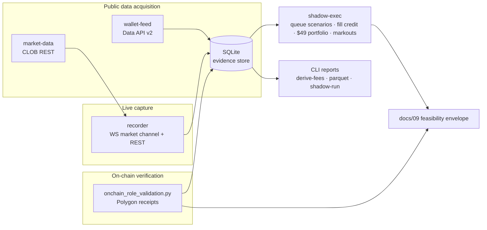

<div align="center">

# Prediction Market Forensics

**An evidence-first research engine for prediction markets — on-chain trader
verification, public market-data capture, and copy-trading feasibility
analysis. Built in Rust. Every number reproducible. No keys, no orders, no
secrets.**


</div>

---

## What this is

A forensic quant laboratory that asks one question about a prediction-market
wallet — **can its results be replicated from public data alone?** — and
answers it the hard way: by reconstructing the trader's complete history
from public APIs, verifying every fill, fee, and share **against the
blockchain itself**, recording live order-book microstructure, and simulating
what a small follower could actually have done.

The studied wallet (`0xa19c…ade6b`, alias *Tokor*) is public on-chain data;
all analysis uses public endpoints only. The engine never authenticates,
never signs, never submits.

## Headline findings

| # | Question | Verdict | Evidence |
|---|---|---|---|
| 1 | Can the trader's economics be reconstructed? | **Yes — to the cent** | 13,965 fills / $3.97M notional reconciled; 0 unexplained fees across the corpus |
| 2 | Is the fee model real? | **Yes — triple-verified** | feed-side, model-side, **and on-chain** (`fee` field in the v2 exchange events) |
| 3 | Who provides liquidity? | **~90% maker** | 90.2% of fills / 59.3% of volume / 62.1% of notional — confirmed on-chain, side-flags 100% |
| 4 | Can a <$50 follower copy the *fills*? | **Unlikely** | mirroring the maker fills costs **2.062% in taker fees alone** ($50,769 on $2.46M) — fees the studied trader provably never paid; spread + queue still unmeasured |
| 5 | Can the *strategy* be reverse-engineered? | **Yes — it's a dip-ladder** | see below; two ladders already resolved in the trader's favor in public data |

## The discovery: a dip-ladder strategy

The trader's dominant activity is a mechanical, one-way accumulation pattern
on crypto "will X dip to $Y" markets:

- **BUY only** — zero sells, ever (82/0, 17/0, 15/0, 14/0 across tracked markets)
- **Maker laddering** — fixed-size resting clips at successively lower rungs
  as the market falls (0.51 → 0.31 → 0.22 → 0.15 → 0.08 on ETH-$1,750)
- **Martingale scaling** — 30,000-share clips near the bottom
- **Hold to resolution** — two ladders have already resolved **in the trader's
  favor**: ETH-$1,500 **+$14,648**, XRP +$2.55

The inputs (price, time, rung spacing) are entirely public. Full write-up:
[`docs/10-strategy-inference.md`](docs/10-strategy-inference.md).

## Architecture



| Crate | Role |
|---|---|
| `tokor-domain` | fill/fee model (the verified single source of truth), Decimal-exact |
| `tokor-wallet-feed` | Data-API ingestion with durable cursors, retry/backoff, forensics |
| `tokor-market-data` | CLOB client, book snapshots |
| `tokor-recorder` | WS market-channel capture: snapshot+delta state machine, gap/staleness invariants |
| `tokor-persistence` | SQLite evidence store: raw frames, normalized books, simulations |
| `tokor-shadow-exec` | queue-ahead scenarios, copy simulators, fill-credit rules, $49 portfolio, markouts |
| `tokor-application` | the `tokor` operator CLI |
| `scripts/` | on-chain decoder/role engine, fee verification, category fetch |

## Verified economics

```
taker fee   = size × rate × p × (1 − p)        (chain-truncated at 1e6 USDC)
maker fee   = 0                                 (on-chain fact, not assumption)
cash(taker) = gross + fee                        (fees are USDC on top)
cash(maker) = gross
```

Triple-verified across 13,965 fills: wallet-feed accounting, Decimal-exact
model tests, and the exchange's own event payloads.

## Quickstart

```bash
# build (static musl-friendly)
./scripts/setup-env.sh
cargo build --release

# reconstruct the trader's history from public data
tokor --config config/default.toml ingest-activity --resume
tokor --config config/default.toml ingest-positions
tokor --config config/default.toml derive-fees

# verify roles + fees against the blockchain
python3 scripts/onchain_role_validation.py

# record live public order books (runs until Ctrl-C)
tokor --config config/default.toml record-market <TOKEN_ID>...

# replay stored fills through the shadow simulators
tokor --config config/default.toml shadow-run --scenario baseline

# gates
cargo clippy --workspace --all-targets -- -D warnings && cargo test --workspace
```

## Documentation

| Doc | Contents |
|---|---|
| [`docs/00`](docs/00-phase0-recon-and-assessment.md) | reconnaissance & threat model |
| [`docs/01`](docs/01-phase1-completion-report.md) | phase-1 data foundation report |
| [`docs/02`](docs/02-fee-model-investigation.md) | fee-model investigation |
| [`docs/03`](docs/03-inventory-reconciliation.md) | inventory reconciliation |
| [`docs/04`](docs/04-event-identity-audit.md) | event-identity & dedup audit |
| [`docs/05`](docs/05-phase15-executive-verdict.md) | phase-1.5 executive verdict |
| [`docs/06`](docs/06-maker-taker-validation.md) | on-chain maker/taker validation |
| [`docs/07`](docs/07-market-data-architecture.md) | market-data architecture & latency |
| [`docs/08`](docs/08-shadow-execution-model.md) | shadow-execution model |
| [`docs/09`](docs/09-execution-feasibility-report.md) | execution-feasibility report (ten questions) |
| [`docs/10`](docs/10-strategy-inference.md) | **strategy inference: the dip-ladder** |

## Methodology & ethics

- **Read-only, always.** The dependency graph contains no order routes;
  the engine holds no keys and performs no authentication (§12).
- **Evidence first.** Raw API bodies and verbatim on-chain receipts are
  retained; every derived number cites its dataset and regeneration command
  ([`docs/09`](docs/09-execution-feasibility-report.md) reproduction appendix).
- **No financial advice.** Findings are historical simulation on public
  data; prediction markets involve substantial risk.

## Naming

The internal `tokor-*` namespace honors the alias of the studied wallet.
The repository name describes the method, not the subject.

## License

MIT — see [LICENSE](LICENSE).
