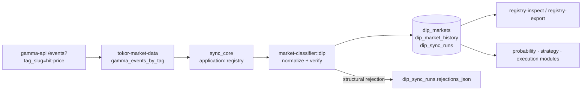

# 11 - Engineering Assignment 001: Canonical ETH/BTC Dip-Market Registry

**Status: implemented · Read-only throughout (§12 constraints preserved) · Verifier version `dip-resver-v0.1.0`**

---

## 1. Objective

A reliable discovery, normalization, verification, and persistence layer for
Ethereum and Bitcoin *dip markets* on Polymarket - the market universe for
the independent adaptive dip-ladder strategy research program. This is the
foundation that lets downstream probability/strategy/execution modules
consume a clean, reproducible, semantics-verified market set - active
markets for live research and resolved markets for backtesting.

This component makes **no trading decisions** and contains **no sizing or
probability logic**. It cannot place orders; the dependency graph has no
order routes.

## 2. Repository assessment (what existed, what was reused)

| Component | Status at assignment start | Disposition |
|---|---|---|
| `MarketDataClient` (market-data) | CLOB `GET /markets/{id}`, Gamma `GET /events?slug=` | **Extended**: added `gamma_events_by_tag` listing + pagination |
| `markets` + `market_tokens` tables | 1,999 rows - wallet-driven (markets Tokor touched) | **Reused** for raw-payload anchoring; registry is a new table family |
| `market-classifier` | Deterministic crypto-scope classifier with evidence (since Phase 1) | **Reused** as scope gate concept; new `dip` module follows its evidence-recording pattern |
| `enrich_market` pipeline | Idempotent CLOB+Gamma upsert, raw payload capture (`clob_meta_json`, `gamma_meta_json`) | **Pattern reused** (verbatim raw retention) |
| CLI conventions | Flat kebab commands, flag-value scanner, `CmdResult` | **Followed** (`registry-sync` / `registry-inspect` / `registry-export`) |
| `tokor-domain` | `MarketRef`, classification types, Decimal-everywhere | **Extended**: new `dip` module |
| Empty scaffold dirs (`research/`, `strategy/`, …) | Untracked, empty | **Ignored** - no premature crate creation |

## 2.1 Source changes (deliverable C)

**Created**

| File | Purpose |
|---|---|
| `crates/domain/src/dip.rs` | Registry domain types: `Asset`, `BarrierSemantics`, `ResolutionStatus`, `ResolutionVerification`, `FeeInfo`, `DipMarket`, `RejectionReason`, `DipNormalization` |
| `crates/market-classifier/src/dip.rs` | Deterministic extractor + resolution verifier (`dip-resver-v0.1.0`): normalization, asset/semantics/window/barrier parsing, ET→UTC |
| `crates/market-classifier/tests/dip_extraction.rs` | Assignment cases 1–10 + parser/gate unit tests (15 tests) |
| `crates/market-classifier/tests/fixtures/*.json` | 4 verbatim Gamma payloads captured 2026-11 (+ README) |
| `migrations/0005_dip_registry.sql` | `dip_markets`, `dip_market_history`, `dip_sync_runs` |
| `crates/persistence/src/dip_registry.rs` | Diffing upsert + append-only history + run ledger (`DipRegistryRepository`) |
| `crates/persistence/tests/dip_registry.rs` | Assignment cases 11–13 + roundtrip + ambiguous-retention (5 tests) |
| `crates/application/src/registry.rs` | `sync_core` (provider-generic) + `registry_sync`/`inspect`/`export` + report formatting |
| `crates/application/src/lib.rs` | Library surface so integration tests drive the CLI's exact code paths |
| `crates/application/tests/registry_sync.rs` | Assignment cases 14–16 + pagination/asset-filter/max-pages (6 tests) |
| `docs/11-dip-market-registry.md` | This document |

**Modified**

| File | Change |
|---|---|
| `crates/domain/src/lib.rs` | Export the `dip` module |
| `crates/market-classifier/src/lib.rs` | Mount `dip` module + re-exports |
| `crates/market-classifier/Cargo.toml` | `chrono`, `rust_decimal` deps; `rust_decimal_macros` dev-dep |
| `crates/market-data/src/lib.rs` | `gamma_events_by_tag` listing method, `urlencode`, wiremock test |
| `crates/persistence/src/lib.rs` | Mount `dip_registry`; register migration 0005; table-count/versions assertions updated |
| `crates/persistence/Cargo.toml` | `tokor-market-classifier` dev-dep (fixtures→normalizer in tests) |
| `crates/application/src/main.rs` | Thin binary over the new lib; `registry-*` commands (parse + dispatch + usage) |
| `crates/application/src/config.rs` | `gamma.page_limit` / `gamma.page_pause_ms` (defaults 100 / 300) |
| `crates/application/src/markets.rs` | `tag_list` visibility (shared with registry) |
| `config/default.toml` | Gamma page tuning keys |


Everything below was verified against live `gamma-api.polymarket.com`
responses on 2026-11-11 (fixtures: `crates/market-classifier/tests/fixtures/`).

### 3.1 Discovery endpoint

```
GET https://gamma-api.polymarket.com/events?tag_slug=hit-price&closed={true|false}&limit=100&offset=N
```

* Returns a JSON **array of event objects**, each embedding its `markets`
  array (event = family of strike markets, e.g. "What price will Bitcoin hit
  in December?" contains every dip/reach strike).
* ~2,102 closed `hit-price` events observed (full pagination scan);
  page size 100 works reliably.
* **Multiple `tag_slug` params do NOT intersect** (verified: requesting
  `tag_slug=ethereum&tag_slug=hit-price` returns events carrying either
  tag). Asset filtering is therefore done **locally** from event tags +
  question + description - never by trusting the listing filter alone.

### 3.2 Market-object fields (verified shapes)

| Field | Verified form | Registry use |
|---|---|---|
| `conditionId` | `0x…` hex string | primary key |
| `question` | e.g. `Will Bitcoin dip to $90,000 by December 31, 2025?` | dip-shape gate, barrier extraction |
| `description` | full resolution contract (verbatim) | **semantics verification** (§4) |
| `outcomes` | JSON-encoded **string**: `"[\"Yes\", \"No\"]"` (double-parse) | YES/NO orientation |
| `clobTokenIds` | JSON-encoded string, positional pair | `yes_token_id` / `no_token_id` |
| `outcomePrices` | JSON-encoded string `"[\"1\", \"0\"]"` | resolution outcome label |
| `orderPriceMinTickSize` | number (`0.001`) | tick size (Decimal-ized at boundary) |
| `orderMinSize` | number (`5`) | min order size |
| `endDate` | ISO-8601 Z | API deadline |
| `closedTime` | `"2025-01-13 16:55:21+00"` (space-separated, no T) | - (recorded in raw payload only) |
| `resolutionMechanism` | `"oracle"` | oracle provenance |
| `resolutionSource` | URL string (may be **empty** - do not rely) | cross-check vs description URL |
| `resolvedBy`, `umaResolutionStatus`, `umaBond`, `umaReward` | UMA metadata | recorded raw |
| `feeType`, `feesEnabled`, `makerBaseFee`, `takerBaseFee` | `"crypto_fees_v2"`, `true`, `1000`, `1000` | **recorded raw only** (§3.4) |
| `negRisk`, `active`, `closed`, `archived` | booleans | lifecycle |
| event-level `tags` | objects `{slug, label}` (sometimes strings) | asset scoping |

### 3.3 Resolution contract templates (the critical finding)

Both verified dip/reach templates carry **touch semantics on 1-minute
Binance candles**, and state an **explicit observation window in the
description that differs from `endDate`**:

> *"This market will immediately resolve to **"Yes"** if any Binance 1 minute
> candle for Bitcoin (**BTCUSDT**) **between December 30, 2024, 20:00 and
> December 31, 2025, 23:59 in the ET timezone** has a final **"Low"** price
> of **$90,000 or lower**. Otherwise, this market will resolve to "No."*

Example divergence (real market): `endDate = 2025-12-31T12:00:00Z` but the
contract window ends `December 31, 2025, 23:59 ET`. **Consequence: the
registry stores both** - `end_date` (API) and `observation_end` (parsed from
contract text; `NULL` when the pattern is unrecognized, never fabricated).

Monthly-template markets phrase the window as *"during the month specified
in the title (from 00:00 AM ET on the first day to 11:59 PM ET on the
last)"* and reference the barrier as *"the price specified in the title"* -
the description may then contain **no numeric barrier**, so the verifier
accepts either a numeric description barrier (cross-checked against the
title) or the explicit title-binding phrase.

### 3.4 Fees - deliberately NOT derived

Gamma reports `feeType=crypto_fees_v2`, `makerBaseFee=1000`,
`takerBaseFee=1000` (bps). These base values **do not** equal the verified
effective taker rate on crypto markets (7%, docs/02/docs/06: fee =
size × rate × p × (1−p)). The registry therefore records the Gamma fee
fields **raw** and derives nothing; effective fee authority remains the
fill-level fee model. Marked UNRESOLVED in §9.

## 4. Resolution-verification mechanism

`verify_resolution` (market-classifier::dip) runs four checks, each
evidence-recording:

1. **Semantics**: explicit threshold sentence → `TouchLowAtMost` (dip:
   candle `"Low"` … "or lower"), `TouchHighAtLeast` (reach), `CloseBased`
   (recorded, ineligible), `Other`.
2. **Source**: description must name Binance **and** yield a
   `https://www.binance.com/…` URL; the named pair (`BTCUSDT`/`ETHUSDT`)
   must match the asset.
3. **Barrier binding**: numeric description barrier == title barrier, or
   the explicit phrase *"the price specified in the title"*.
4. **Asset consistency**: pair/question/tags signals must agree; conflicts
   are rejections, never guesses.

Outcomes: **VERIFIED** (all pass) · **AMBIGUOUS** (load-bearing
contradiction, e.g. title≠description barrier - retained, never eligible) ·
**REJECTED** (no settlement text / no source - retained, never eligible) ·
**UNVERIFIED** (not yet run). Timestamp + verifier version + verbatim
evidence excerpts are persisted with every verdict.

## 5. Architecture



* `domain::dip` - typed model (`Asset`, `BarrierSemantics`,
  `ResolutionStatus`, `ResolutionVerification`, `DipMarket`,
  `RejectionReason`), Decimal-exact.
* `market-classifier::dip` - pure, deterministic extraction + verification;
  versioned; no I/O.
* `market-data::gamma_events_by_tag` - verified listing endpoint.
* `persistence::dip_registry` - diffing upsert with append-only history;
  run ledger.
* `application::registry` - provider-generic `sync_core` (fixtures in
  tests) + production `registry_sync` (blocking thread + current-thread
  runtime; never `block_on` inside the ambient runtime) + inspect/export.
* application crate now has a **library target** so integration tests drive
  the exact code the CLI runs.

## 6. Data model

`dip_markets` - one row per BTC/ETH dip candidate discovered; verbatim
`resolution_rule`; `eligible` + `reject_reason` re-derived on every change;
`metadata_version` bumped on any drift.

`dip_market_history` - append-only field-level before/after on every change
(directional reverts are recorded as changes; nothing is silently
overwritten).

`dip_sync_runs` - per-invocation observability: pages/events/markets seen,
discovered/new/updated/unchanged/rejected/resolved-retained/out-of-scope,
rejection reasons, error strings, `RUNNING`→`COMPLETE` |
`COMPLETE_WITH_ERRORS`.

Idempotency: re-syncing identical payloads is `Unchanged` (touch-updates
`last_synced_at` only). Malformed payloads → structural rejections in the
run ledger. The registry deliberately **retains** ambiguous/rejected
candidates (evidence preservation + reproducible counts).

## 7. CLI

```bash
tokor --config config/default.toml registry-sync \
      [--assets BTC,ETH] [--universe active|resolved|all] [--max-pages N]
tokor --config config/default.toml registry-inspect \
      [--asset BTC|ETH] [--eligible] [--limit N]
tokor --config config/default.toml registry-export \
      [--asset BTC|ETH] [--eligible] [--limit N] --output data/markets/eth_btc_registry.json
```

## 8. Test matrix coverage (assignment §7)

| # | Case | Test |
|---|---|---|
| 1 | Valid BTC dip | `btc_dip_fixture_is_verified_and_eligible` |
| 2 | Valid ETH dip | `eth_dip_fixture_is_verified_and_eligible` |
| 3 | Unrelated crypto (SOL) | `solana_dip_is_rejected_unsupported_asset` |
| 4 | Non-crypto market | `non_crypto_market_is_rejected` |
| 5 | Missing condition id | `missing_condition_id_rejected` |
| 6 | Missing token ids | `missing_tokens_rejected` + `identical_tokens_rejected` |
| 7 | Invalid barrier | `invalid_barrier_rejected` |
| 8 | Invalid deadline | `invalid_deadline_rejected` |
| 9 | Ambiguous resolution | `ambiguous_barrier_rejected_despite_valid_title` |
| 10 | Unverified source | `unverified_source_rejected` |
| 11 | Duplicate discovery | `duplicate_market_discovery_is_idempotent` |
| 12 | Metadata changes | `metadata_change_creates_history_and_bumps_version` |
| 13 | Resolved retention | `resolved_market_retained` + roundtrip test |
| 14 | Repeated sync | `repeated_synchronization_is_idempotent` |
| 15 | Malformed API responses | `malformed_api_responses_are_recorded` |
| 16 | Partial API failures | `partial_api_failures_stop_cleanly_and_keep_data` |

Plus: pagination stop/max-pages bounds, asset-filter scoping, barrier
parser, dip-shape gate, asset-conflict rejection, row roundtrip fidelity,
Gamma listing client (wiremock). Real-API fixtures: 4 captured payloads
(see `tests/fixtures/README.md`).

## 9. Outstanding risks / unresolved items

1. **Effective fee schedule from Gamma is unresolved** - `makerBaseFee=1000`
   bps ≠ verified 7% effective taker rate. Registry records raw; effective
   fees must come from the fill-level model (docs/02). Do not read strategy
   economics from these columns.
2. **ET→UTC conversion uses the post-2007 US DST rule** (second Sunday March
   → first Sunday November). Verified contracts state ET explicitly; markets
   in other timezones would parse with a recorded note or not at all.
3. **Window-parse patterns are template-specific** (explicit "between…and"
   and "month specified in the title" verified). Other phrasings →
   `observation_end = NULL` with note; eligibility does not depend on it.
4. **`closedTime` has a non-ISO format** (`"2025-01-13 16:55:21+00"`);
   recorded raw only.
5. **Discovery is listing-scoped** (`hit-price` tag). A dip-shaped market
   without that tag would be missed; a periodic full-crypto sweep is a
   possible follow-up.
6. **CLOB cross-verification** of tick/min-size per condition (the
   `enrich-market` path) is not wired into sync; Gamma values are recorded
   as-is. Recommended before execution research depends on tick lattices.
7. **Reach (touch-high) markets are out of scope** by assignment but are
   recognized and counted; a symmetric registry later would reuse the same
   machinery.

## 10. Next engineering task

The registry surfaces exactly what the strategy engine needs next: a
**dip-outcome dataset builder** - join verified historical dip markets to
Binance 1-minute klines (the contracts' own resolution source) to compute
first-touch times, rung spacing statistics, and per-strike base rates. That
produces the calibration targets for the probability model and, with the
shadow-exec harness, the first backtestable adaptive-ladder parameters.
